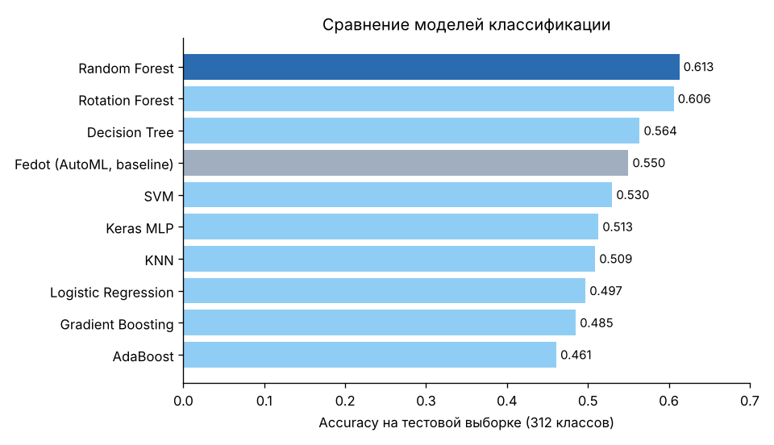
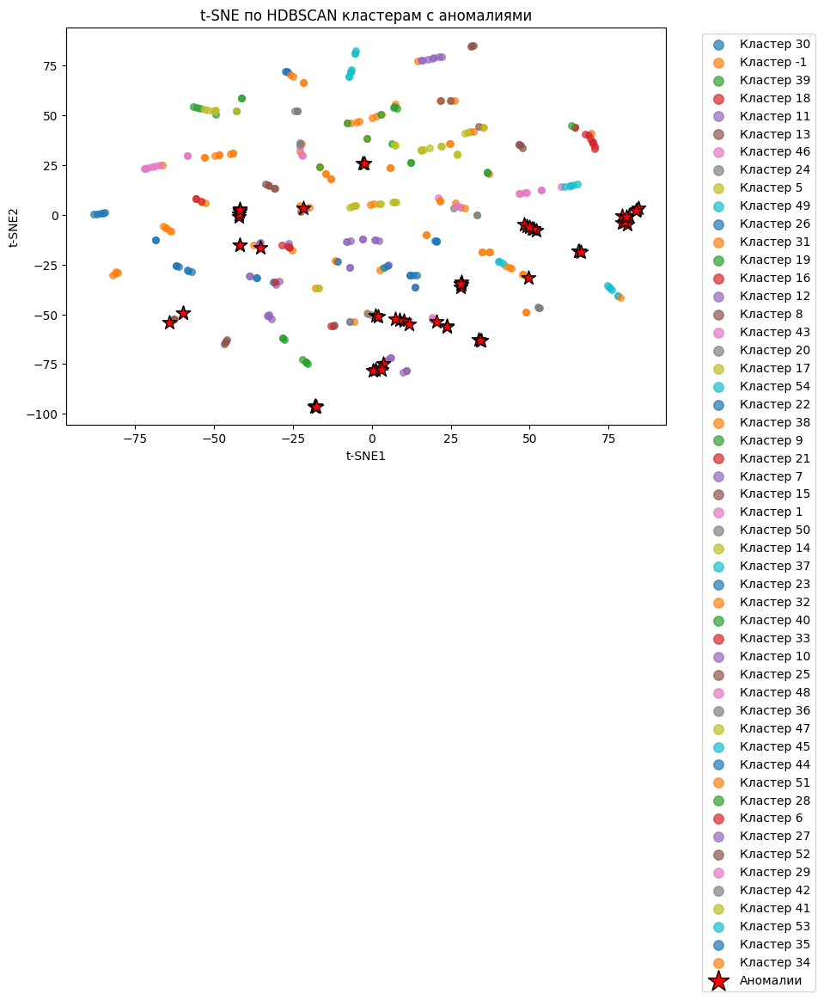

# ВКР: многоклассовая классификация объектов основных средств

🇷🇺 Русский · [🇬🇧 English](#-english)

**Задача.** По характеристикам объекта основных средств (эксплуатирующая организация, регион, срок эксплуатации, стоимость, основное свойство, его значение и единица измерения) автоматически определить тип объекта. Это 312 классов, от зданий и сетей до технологических установок. Перед моделированием нужно было исследовать структуру реестра, выделить группы похожих объектов и найти аномалии.

**Данные.** Реестр основных средств инфраструктурных компаний: ~12,6 тыс. объектов, 383 наименования. ⚠️ **Данные конфиденциальны:** организации, регионы и округа обезличены, стоимость умножена на коэффициент, а сам датасет в репозиторий не включён.

**Формат.** Выпускная квалификационная работа, бакалавриат «Экономика», 2026.

## Что сделано

1. **Предобработка:** обезличивание, заполнение 12,9% пропусков каскадной медианой по группам: от узких (свойство + организация + регион) к широким (только свойство). Остаток пропусков — 0,4%. Проверка мнимых дубликатов (объекты с одинаковыми признаками, но разными инвентарными номерами).
2. **Разведочный анализ:** концентрация объектов по округам, регионам и организациям, проблема редких классов. Связи между признаками: Спирмен для числовых, **V Крамера** для категориальных.
3. **Кластеризация смешанных данных:** DBSCAN и **HDBSCAN на матрице расстояний Gower** с подбором параметров по силуэту и доле шума. Визуализация через PCA → **t-SNE** с подбором perplexity и learning rate.
4. **Поиск аномалий:** **Isolation Forest** с подбором гиперпараметров, анализ доли аномалий по кластерам.
5. **Подготовка признаков:** преобразование Йео–Джонсона, отбор признаков по корреляции и **VIF**.
6. **Классификация на 312 классов** со стратифицированным разбиением и сравнением способов балансировки: Random Oversampling, SMOTE, SMOTENC и собственный `GaussianNoiseSampler`. Перебор гиперпараметров для 10+ моделей: логистическая регрессия, SVM, KNN, дерево решений, **Random Forest**, Rotation Forest, Gradient Boosting, AdaBoost, CatBoost, нейросеть на Keras, а также AutoML (**Fedot**) как точка отсчёта.

## Ключевые результаты

| Модель | Accuracy (test) |
|---|---|
| **Random Forest** | **0,613** |
| Rotation Forest | 0,606 |
| Decision Tree | 0,564 |
| Fedot (AutoML, baseline) | 0,550 (macro-F1 0,38, weighted-F1 0,56) |
| SVM | 0,530 |
| Keras MLP | 0,513 |

- Лучший результат у **Random Forest: 61% верных ответов среди 312 классов**. Случайное угадывание дало бы ~0,3%.
- Ансамбли деревьев стабильно опережают линейные модели и бустинг на этих данных, а простой Random Oversampling работает не хуже SMOTE.
- HDBSCAN с метрикой Gower выделил плотные группы похожих объектов, а редкие комбинации признаков попали в шум. Isolation Forest показал, что аномалии сосредоточены в редких кластерах.

## Ограничения и что дальше

- Macro-F1 заметно ниже accuracy: редкие классы распознаются плохо. Помогли бы иерархическая классификация (сначала группа объектов, затем тип) и объединение редких классов.
- Модели с долгим обучением (Gradient Boosting, Fedot) не удалось глубоко настроить из-за вычислительных ресурсов.

## Стек

Python · pandas · scikit-learn · imbalanced-learn · HDBSCAN · gower · CatBoost · TensorFlow/Keras · Fedot · plotly · seaborn

---

## 🇬🇧 English

**Bachelor's thesis: multi-class classification of fixed assets (312 classes)**

**Goal.** Predict the type of a fixed asset (312 classes) from its attributes: operator, region, age, cost, main property, its value and unit of measure. ~12.6k records. ⚠️ The data is confidential: it was anonymised and is not published.

**What was done**
- Cascading group-median imputation of missing values.
- EDA with Spearman correlation and Cramér's V.
- Clustering of mixed-type data with HDBSCAN on a Gower distance matrix, t-SNE visualisation and Isolation Forest anomaly detection.
- Feature selection by correlation and VIF.
- Benchmark of 10+ classifiers (Logistic Regression, SVM, KNN, trees, Random Forest, Rotation Forest, Gradient Boosting, AdaBoost, CatBoost, Keras MLP and the Fedot AutoML baseline) with ROS, SMOTE, SMOTENC and custom Gaussian-noise balancing.

**Result.** Random Forest reached **0.613 test accuracy across 312 classes** (chance level ≈ 0.003). Tree ensembles outperformed linear models and boosting. Next steps: hierarchical classification to improve macro-F1 on rare classes.
