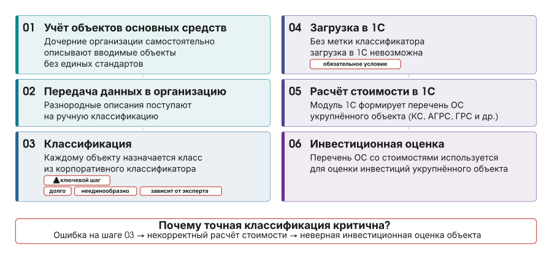
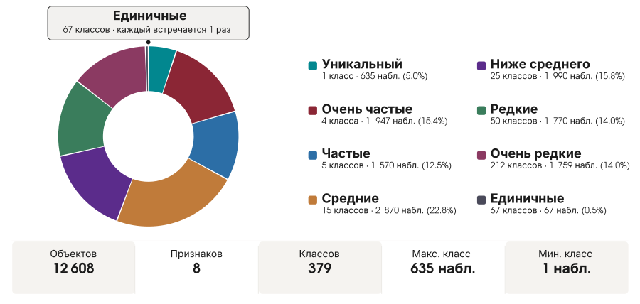
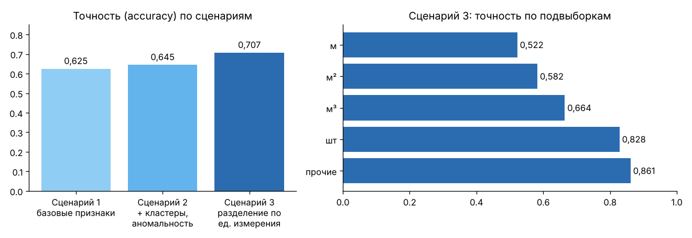
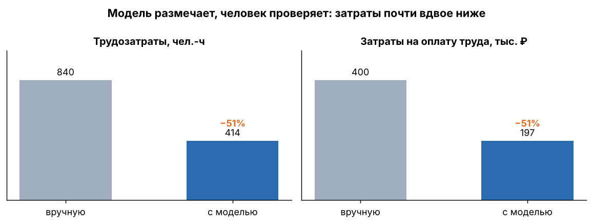
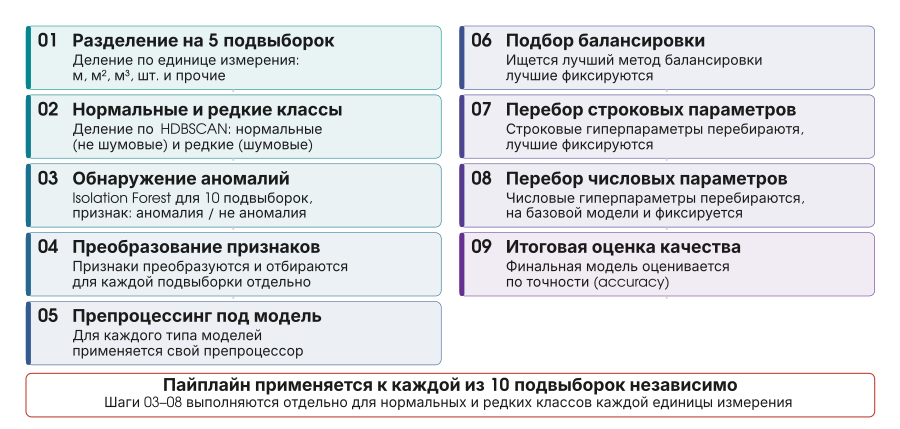

# Классификация объектов основных средств методами машинного обучения

Моя выпускная работа в бакалавриате СПбГЭУ (2026, кафедра прикладной математики и экономико-математических методов). Делал на реальных данных ООО «НИИгазэкономика», компания выдала справку о том, что результаты работы представляют для неё практический интерес.

[English version below](#english)

## Зачем это нужно

Дочерние общества заводят новые объекты основных средств каждое по-своему, без единого стандарта описания. Чтобы загрузить объект в 1С и посчитать стоимость укрупнённого объекта (компрессорной станции, ГРС и т. п.), каждому нужно вручную присвоить класс из корпоративного классификатора. Это долго, зависит от эксперта, и ошибка на этом шаге потом уходит в инвестиционную оценку.

Задача: по характеристикам объекта автоматически предсказать его класс.

## Данные

12 659 объектов, у каждого: организация, регион, объект-родитель, основное свойство и его значение с единицей измерения, срок эксплуатации, стоимость. Целевая переменная — наименование по классификатору.

Главная сложность — классов много и они очень неравномерные: часть встречается сотни раз, а 67 классов всего по одному разу. Плюс одинаковое оборудование описано по-разному, и классы пересекаются по смыслу.

Данные конфиденциальные. Организации, регионы и объекты-родители заменены кодами, стоимость умножена на коэффициент, сам датасет здесь не выложен.

## Что делал

1. Предобработка: пропуски заполнял медианой внутри групп похожих объектов, привёл к одному написанию категории, проверил дубликаты.
2. Разведочный анализ: распределения, Спирмен для числовых признаков, V Крамера для категориальных.
3. Кластеризация HDBSCAN на расстоянии Gower (данные смешанные) и поиск аномалий через Isolation Forest. Из этого сделал новые признаки: метку кластера, редкость класса, аномальность объекта. Отбор по корреляции и VIF сократил признаки с 30 до 18.
4. Сравнил десяток моделей: SVC, KNN, дерево, Random Forest, Rotation Forest, Extra Trees, Easy Ensemble, HistGradientBoosting, AdaBoost, нейросеть на Keras. Балансировку (oversampling, веса классов) и гиперпараметры подбирал под каждую модель.
5. Перебрал три сценария, каждый сложнее предыдущего.

## Результаты

| Сценарий | Что менялось | Лучшая модель | Accuracy |
|---|---|---|---|
| 1 | базовый набор признаков | AdaBoost | 0,625 |
| 2 | + кластеры, редкость, аномальность | Random Forest | 0,645 |
| 3 | отдельная модель для каждой единицы измерения (м, м², м³, шт, прочие) | лучшая модель в каждой группе | **0,707** (средневзвешенная) |

**Главная находка: задачу выгоднее разбить на части, чем усложнять модель.** Новые признаки дали +2 п.п., а разделение по единицам измерения ещё +6 п.п. Внутри одной единицы измерения объекты однороднее, а конкурирующих классов меньше. Для группы «шт» точность 0,83, для «прочих» 0,86, сложнее всего с протяжёнными объектами в метрах (0,52).

Важность признаков и SHAP показали одно и то же: модель опирается на стоимость, техническое состояние объекта и его место в структуре данных.

**Экономический эффект.** Если модель размечает объекты, а человек только проверяет, трудозатраты на разметку всего массива снижаются с 840 до 414 чел.-ч, а затраты на оплату труда — с 400 до 197 тыс. ₽. Время на один объект падает, потому что проверить готовую метку быстрее, чем найти класс с нуля.

## Файлы

- `notebooks/01_eda_and_first_experiments.ipynb` — первая версия: разведочный анализ, кластеризация, аномалии, первые модели на всех классах сразу.
- `notebooks/02_final_pipeline.ipynb` — итоговый пайплайн из ВКР: три сценария и расчёт эффекта.

Python, pandas, scikit-learn, imbalanced-learn, hdbscan, gower, CatBoost, SHAP, TensorFlow/Keras.

---

## English

My bachelor's thesis (St Petersburg State University of Economics, 2026), built on real fixed-asset data from NIIgazekonomika. The company issued a letter confirming the results are of practical interest to them.

The task was to predict an asset's class in the corporate classifier from its attributes. The data had 12,659 assets and hundreds of heavily imbalanced classes, 67 of which appear only once. I used HDBSCAN on a Gower distance matrix and Isolation Forest to engineer cluster, rarity and anomaly features, then benchmarked around ten classifiers with tuned balancing.

Splitting the task by unit of measure and training a separate model per group raised weighted accuracy from 0.625 to 0.707. The estimated effect is that manual labelling effort drops from 840 to 414 person-hours. The data is confidential and anonymised, so it is not included here.
